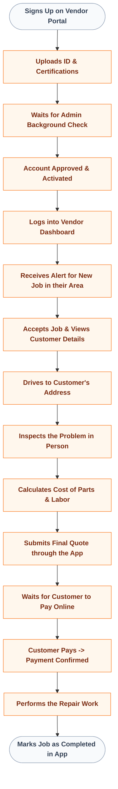

# DoneMachi - User Journeys & Master Process

---

## PART 1: Individual User Experiences

### 1. The Customer Experience
*How a customer uses the platform from start to finish.*

```mermaid
flowchart TD
    A([Visits DoneMachi Website]) --> B[Selects Service Category (e.g., Plumbing, AC)]
    B --> C[Picks the specific problem they are facing]
    C --> D[Enters Name, Phone Number, and Address]
    D --> E[Reviews Cart & ₹150 Inspection Fee]
    E --> F[Pays ₹150 Upfront Online]
    F --> G[Receives Booking Confirmation & Order Number]
    G --> H[Tracks Vendor Status on Dashboard]
    H --> I[Vendor Arrives and Inspects the Problem]
    I --> J[Receives Final Repair Quote on Phone]
    J --> K{Agrees to Price?}
    K -->|No| L([Cancels Job - Only loses ₹150])
    K -->|Yes| M[Pays Final Quote Amount Online]
    M --> N[Vendor Completes the Repair Work]
    N --> O([Leaves a Rating & Review])
    
    classDef default fill:#eff6ff,stroke:#3b82f6,color:#1e3a8a,font-weight:bold;
    classDef terminal fill:#f8fafc,stroke:#94a3b8,color:#334155,font-weight:bold;
    class A,L,O terminal;
```

### 2. The Vendor Experience
*How a service professional uses the platform to get jobs.*



### 3. Admin Powers & Capabilities
*Unlike customers and vendors, admins do not have a linear "journey". Instead, they use a Command Center to govern the platform. Here is what they can do:*

*   **Vendor Management**: Review uploaded documents, run background checks, and Approve or Ban vendors.
*   **Live Booking Oversight**: Monitor every active job in real-time on a global map/list.
*   **Manual Override**: Manually reassign a job from one vendor to another if someone is running late.
*   **Financial Control**: Issue partial or full refunds to unhappy customers directly from the dashboard.
*   **Dispute Resolution**: Intervene in chats or disputes between customers and vendors.
*   **Catalog Management**: Add new service categories, update symptoms, and change baseline prices.

---

## PART 2: The Big Detailed Master Flow
*Every single step of the business process, in order, without skipping anything.*

```mermaid
flowchart TD
    %% Step 1: Request
    1([Customer visits website]) --> 2[Customer browses services and selects their problem]
    2 --> 3[Customer enters their phone number and home address]
    3 --> 4[Customer pays the ₹150 Inspection Fee upfront]
    
    %% Step 2: System Routing
    4 --> 5[System successfully charges card and creates an Order Number]
    5 --> 6[System alerts approved Vendors near the customer's address]
    
    %% Step 3: Dispatch & Inspection
    6 --> 7[A Vendor accepts the job via their dashboard]
    7 --> 8[Vendor receives the customer's exact address and phone number]
    8 --> 9[Vendor drives to the customer's home]
    9 --> 10[Vendor inspects the broken appliance or issue]
    
    %% Step 4: Quoting
    10 --> 11[Vendor calculates the exact cost to fix it]
    11 --> 12[Vendor types the final price into their DoneMachi app and sends it]
    12 --> 13[Customer gets a notification to check the final quote]
    
    %% Step 5: Decision & Payment
    13 --> 14{Customer reviews the price}
    14 -->|Declines| 15([Job is cancelled. Vendor leaves. Customer only paid ₹150])
    14 -->|Approves| 16[Customer pays the final quote amount online]
    
    %% Step 6: Execution & Wrap Up
    16 --> 17[Vendor's app says 'Payment Received']
    17 --> 18[Vendor does the actual repair work]
    18 --> 19[Vendor clicks 'Job Done' in their app]
    19 --> 20[Customer gets a prompt to leave a 5-star review]
    20 --> 21([Admin sees the job is successfully closed and money is routed])
    
    %% Styling
    classDef step fill:#f8fafc,stroke:#475569,stroke-width:2px,color:#0f172a,font-weight:bold;
    classDef decision fill:#fef3c7,stroke:#d97706,stroke-width:2px,color:#92400e,font-weight:bold;
    classDef terminal fill:#e2e8f0,stroke:#64748b,stroke-width:2px,color:#334155,font-weight:bold;
    
    class 1,15,21 terminal;
    class 14 decision;
    class 2,3,4,5,6,7,8,9,10,11,12,13,16,17,18,19,20 step;
```


